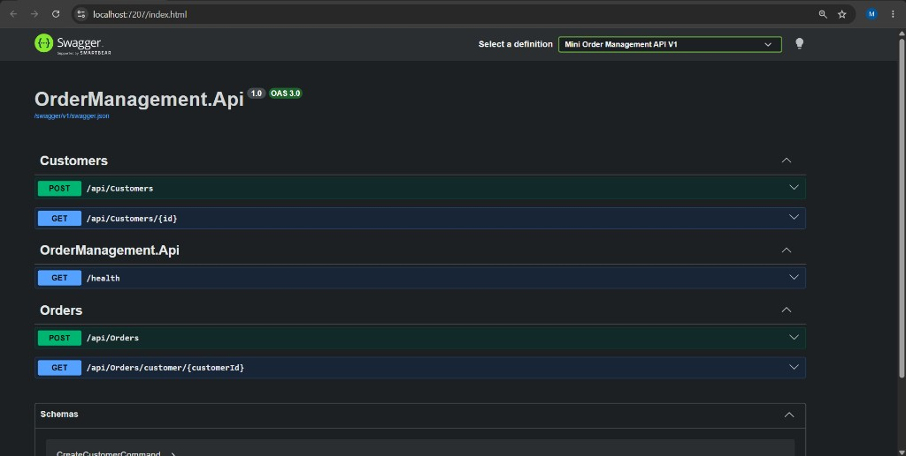

# Mini Order Management Application

Small ASP.NET Core backend that manages customers, customer profiles, and orders. It is organised with Clean Architecture so the domain model stays independent of Entity Framework Core and the HTTP API.

## Design approach

The application uses domain-driven design.

`Customer` is the aggregate root. Creating a customer also creates that customer's profile, and an order is added through `Customer.AddOrder`. Entities keep their setters private and expose behaviour through constructors and methods. `Order` rejects a total that is not greater than zero. The Domain project references no infrastructure packages, so persistence and HTTP details cannot leak into the model.

Persistence mapping lives in Infrastructure Fluent API configurations. Application handlers coordinate use cases. Controllers only send commands and queries.

Unit tests are an optional bonus. The `OrderManagement.Tests` project checks validator rules and one repository round-trip. It is not the design driver for the application.

## Project structure

```
OrderManagement.slnx
src/
  OrderManagement.Domain/           Entities and repository contracts
  OrderManagement.Application/      Commands, queries, validation, MediatR
  OrderManagement.Infrastructure/   EF Core, repositories, Unit of Work, migrations
  OrderManagement.Api/              Controllers, Swagger, composition root
tests/
  OrderManagement.Tests/
```

Dependencies point inward:

- Domain has no project references.
- Application references Domain.
- Infrastructure references Domain. It implements the repository contracts and does not contain business rules.
- The API references Application and Infrastructure. `Program.cs` is the composition root that registers both.

## Domain model

| Entity | Role |
|---|---|
| `Customer` | Name and email. Owns one profile and many orders. |
| `CustomerProfile` | Address and phone number. Shares the customer's id as its primary key. |
| `Order` | Customer id, order date (UTC at creation), and total amount. |

Relationships, configured in `CustomerConfiguration`:

- Customer to Order is one-to-many. Deleting a customer cascades to orders.
- Customer to Customer Profile is one-to-one. The profile's primary key is `CustomerId`, so a customer cannot have two profiles. Deleting a customer cascades to the profile.

Rules enforced by the model and the application:

- A customer can place multiple orders.
- Each customer is created with exactly one profile.
- An order has an order date and a total amount greater than zero.

## CQRS

Write and read operations are separate MediatR requests. `AddApplication` registers handlers, FluentValidation validators, and a pipeline behaviour from the Application assembly.

`ValidationBehavior` runs before every handler. If validation fails, the handler is not called.

| Type | Request | Handler responsibility |
|---|---|---|
| Command | `CreateCustomerCommand` | Build a `Customer` (and its profile) and save it. |
| Command | `CreateOrderCommand` | Load the customer, call `AddOrder`, and save the order. |
| Query | `GetCustomerByIdQuery` | Return the customer, profile, and orders. |
| Query | `GetOrdersByCustomerIdQuery` | Return that customer's orders. |

Request flow:

1. The controller receives the HTTP request and calls `ISender.Send`.
2. MediatR runs `ValidationBehavior`.
3. The matching handler uses `IUnitOfWork`.
4. The handler returns an id or a DTO. The controller turns that into an HTTP response.

Controllers stay thin. They do not validate input or talk to Entity Framework.

| Method | Route | Request |
|---|---|---|
| `POST` | `/api/customers` | `CreateCustomerCommand` |
| `GET` | `/api/customers/{id}` | `GetCustomerByIdQuery` |
| `POST` | `/api/orders` | `CreateOrderCommand` |
| `GET` | `/api/orders/customer/{customerId}` | `GetOrdersByCustomerIdQuery` |

Create customer:

```json
{
  "name": "Alice Smith",
  "email": "alice@example.com",
  "address": "123 MG Road, Bengaluru",
  "phoneNumber": "9876543210"
}
```

Create order:

```json
{
  "customerId": "00000000-0000-0000-0000-000000000000",
  "totalAmount": 250.00
}
```

`GET /api/customers/{id}` returns 404 when the customer does not exist. A successful create returns the new id.

## Validation

Validators live next to their commands and are registered with `AddValidatorsFromAssembly`.

- Customer name, email, address, and phone number are required. Email must be a valid address.
- Order total must be greater than zero. The same rule is enforced again in the `Order` constructor.
- The customer must already exist before an order is created. `CreateOrderCommandValidator` checks this through `IUnitOfWork`.

A failed validator throws `ValidationException`. The API catches that exception and returns HTTP 400 with the property errors. Other exceptions are left to the host.

## Repository and Unit of Work

Application code depends on `IUnitOfWork`, not on concrete repositories or `DbContext`.

```csharp
public interface IUnitOfWork
{
    ICustomerRepository Customers { get; }
    IOrderRepository Orders { get; }
    Task<int> SaveChangesAsync(CancellationToken cancellationToken = default);
}
```

`UnitOfWork` creates `CustomerRepository` and `OrderRepository` on first use and shares one `ApplicationDbContext` between them. Handlers never receive a repository from dependency injection. A command that touches both a customer and an order still calls `SaveChangesAsync` once, and Entity Framework commits that unit of work in a single transaction.

Repositories only load and add entities:

- Writes use a tracked `DbContext`, so `SaveChangesAsync` persists new customers, profiles, and orders through change tracking.
- Read queries use `AsNoTracking` because they do not update entities.
- `GetCustomerWithProfileAndOrdersAsync` uses `Include` for the profile and the orders.

`IUnitOfWork` is registered as scoped, so each HTTP request gets one context.

## Dependency injection and logging

`Program.cs` calls `AddApplication` and `AddInfrastructure`. Handlers, validators, the validation pipeline, `DbContext`, and `IUnitOfWork` are all resolved from the container.

Command handlers take `ILogger<T>` and log the new customer or order id after a successful save. Logging levels are configured in `appsettings.json`.

## Database and migrations

The schema is Code First. Entity classes have no EF attributes. `CustomerConfiguration`, `CustomerProfileConfiguration`, and `OrderConfiguration` define keys, required columns, lengths, decimal precision, and both relationships. `ApplicationDbContext.OnModelCreating` applies every configuration in the Infrastructure assembly.

The initial migration is `Migrations/20261027194419_InitialCreate.cs`. It creates `Customers`, `CustomerProfiles`, and `Orders`.

The connection string is `DefaultConnection` in `src/OrderManagement.Api/appsettings.json`. The default database is LocalDB:

`Server=(localdb)\MSSQLLocalDB;Database=OrderManagementDB;Trusted_Connection=True;MultipleActiveResultSets=true`

From the repository root, install the EF tool once, apply the existing migration, and add a new migration after a model change:

```bash
dotnet tool install --global dotnet-ef
dotnet ef database update --project src/OrderManagement.Infrastructure --startup-project src/OrderManagement.Api
dotnet ef migrations add <Name> --project src/OrderManagement.Infrastructure --startup-project src/OrderManagement.Api
```

The startup project is the API because that is where the connection string and `AddDbContext` registration live. The design-time package `Microsoft.EntityFrameworkCore.Design` is referenced by the API project.

## Run the API and open Swagger

Requirements: .NET 10 SDK and SQL Server LocalDB. Apply the migration before creating data.

```bash
dotnet run --project src/OrderManagement.Api --launch-profile https
```

Swagger is enabled only when `ASPNETCORE_ENVIRONMENT` is `Development`, which the launch profiles set. Swagger UI is served at the site root (`RoutePrefix` is empty), not under `/swagger`.

- HTTPS profile: [https://localhost:7207](https://localhost:7207)
- HTTP profile: [http://localhost:5056](http://localhost:5056)
- OpenAPI document: `/swagger/v1/swagger.json`

`GET /health` returns a small status payload and is separate from Swagger UI.



## Tests

The test project is optional coverage, not a full suite.

- `CreateCustomerCommandValidatorTests` rejects an invalid email.
- `CreateOrderCommandValidatorTests` rejects an order for a missing customer and accepts one for an existing customer.
- `OrderRepositoryTests` saves a customer with a profile, adds an order through the unit of work, and reads it back.

```bash
dotnet test
```
